# Anexo 2. Arquitectura del Sistema — MI BARRIO SEGURO

Diagrama de arquitectura de la aplicación móvil multiplataforma desarrollada en Flutter, bajo el patrón MVVM con gestión de estado Provider, conectada a MongoDB Atlas en la nube.

## Diagrama de componentes (PlantUML)

```plantuml
@startuml MI_BARRIO_SEGURO_Arquitectura
!theme plain
skinparam backgroundColor #FFFFFF
skinparam defaultFontSize 12
skinparam componentStyle rectangle
skinparam packageStyle frame
skinparam shadowing false
skinparam ArrowColor #37474F
skinparam roundCorner 8

title <b>MI BARRIO SEGURO</b>\nArquitectura de la aplicación (Flutter + MVVM + MongoDB Atlas)

' ============================================================
' CAPA DE PRESENTACIÓN
' ============================================================
package "Capa de Presentación (UI) - Flutter" as UI #E3F2FD {

  package "Pantallas (Screens)" as Screens #BBDEFB {
    component "RoleSelectionScreen\n(Selección Vecino/Agente)" as ScrRole
    component "LoginScreen" as ScrLogin
    component "RegisterScreen\n(Vecino / Agente)" as ScrReg
    component "PermissionScreen\n(Permisos y GPS)" as ScrPerm
    component "HomeScreen\n(Botones de emergencia)" as ScrHome
    component "AgentHomeScreen\n(Mapa de incidentes)" as ScrAgent
    component "ReportScreen\n(Reportes + foto)" as ScrReport
    component "ChatScreen\n(Chat vecinal)" as ScrChat
    component "SettingsScreen\n(Perfil + Buzón)" as ScrSet
  }

  package "ViewModels (Provider - MVVM)" as VMs #C8E6C9 {
    component "AuthViewModel" as VMAuth
    component "NeighborViewModel" as VMNb
    component "AgentViewModel" as VMAg
  }

  component "MultiProvider\n(Gestión de estado)" as Provider
}

' ============================================================
' CAPA DE SERVICIOS
' ============================================================
package "Capa de Servicios (Core)" as Services #FFF3E0 {
  component "AuthService\n(Login/registro, SHA-256)" as SAuth
  component "EmergencyService\n(Alertas de emergencia)" as SEmer
  component "ReportService\n(Reportes y sugerencias)" as SRep
  component "ChatService\n(Mensajes, polling 2s)" as SChat
  component "AgentService\n(Stream incidentes 5s)" as SAgent
  component "LocationService\n(Tracking continuo)" as SLoc
  component "MongoDBService\n(Singleton de conexión)" as SMongo
  component "PermissionService\n(Ubicación/Notificaciones)" as SPerm
}

' ============================================================
' CAPA DE MODELOS
' ============================================================
package "Capa de Modelos (Data)" as Models #F3E5F5 {
  entity "UserModel\n(nombre, correo, teléfono,\nbarrio, rol, institución,\ncredencial)" as MUser
  entity "IncidentModel\n(tipo, lat/lng, estado,\nfecha y hora)" as MInc
}

' ============================================================
' SERVICIOS DEL DISPOSITIVO
' ============================================================
package "Servicios del Dispositivo (Android / iOS)" as Device #FFEBEE {
  component "GPS\n(geolocator)" as DGPS
  component "Google Maps\n(google_maps_flutter)" as DMaps
  component "Cámara\n(image_picker)" as DCam
  component "Almacenamiento local\n(SharedPreferences - sesión)" as DPref
  component "Notificaciones\n(permiso POST_NOTIFICATIONS)" as DNotif
}

' ============================================================
' BASE DE DATOS EN LA NUBE
' ============================================================
database "MongoDB Atlas\n(Clúster en la nube - NoSQL)" as Atlas #ECEFF1 {
  folder "Base de datos:\nmi_barrio_seguro" as DB {
    entity "users" as CUsers
    entity "alerts" as CAlerts
    entity "reports" as CReports
    entity "messages" as CMessages
    entity "suggestions" as CSugg
  }
}

' ============================================================
' RELACIONES UI -> ViewModels -> Servicios
' ============================================================
Provider ..> VMAuth
Provider ..> VMNb
Provider ..> VMAg

ScrRole --> VMAuth
ScrLogin --> VMAuth
ScrReg --> VMAuth
ScrPerm --> SPerm

ScrHome --> VMNb
ScrReport --> VMNb
ScrChat --> VMNb
ScrSet --> VMNb

ScrAgent --> VMAg

VMAuth --> SAuth
VMNb --> SEmer
VMNb --> SRep
VMNb --> SChat
VMAg --> SAgent

' ============================================================
' RELACIONES Servicios -> Modelos / MongoDB / Dispositivo
' ============================================================
SAuth --> MUser
SEmer --> MInc
SRep --> MInc
SAgent --> MInc

SAuth --> SMongo
SEmer --> SMongo
SRep --> SMongo
SChat --> SMongo
SAgent --> SMongo

SLoc --> DGPS
ScrHome --> DGPS : ubicación de alerta
ScrReport --> DCam : foto de evidencia
ScrReport --> DGPS : ubicación del reporte
ScrAgent --> DMaps : marcadores de incidentes
ScrHome --> DMaps : mapa del barrio
VMAuth --> DPref : sesión persistente
SPerm --> DNotif

' ============================================================
' CONEXIÓN A LA NUBE
' ============================================================
SMongo --> Atlas : mongodb+srv\n(TLS)

SAuth --> CUsers
SEmer --> CAlerts
SRep --> CReports
SRep --> CSugg
SChat --> CMessages
SAgent --> CAlerts : stream de alertas activas
SAgent --> CReports : reportes pendientes

legend right
  |<#E3F2FD>      | Capa de Presentación (UI)      |
  |<#C8E6C9>      | ViewModels (MVVM - Provider)   |
  |<#FFF3E0>      | Capa de Servicios              |
  |<#F3E5F5>      | Capa de Modelos                |
  |<#FFEBEE>      | Servicios del Dispositivo      |
  |<#ECEFF1>      | MongoDB Atlas (nube)           |
endlegend

@enduml
```

## Descripción de las capas

| Capa | Ubicación en el código | Responsabilidad |
|---|---|---|
| **Presentación (UI)** | `lib/features/*/presentation/screens` | Pantallas de la aplicación. No acceden directamente a los datos. |
| **ViewModels (MVVM)** | `lib/features/*/presentation/viewmodels` | Lógica de presentación y estado, expuestos a la UI mediante `MultiProvider`. |
| **Servicios (Core)** | `lib/core/services` | Lógica de negocio y acceso a datos: autenticación (SHA-256), alertas de emergencia, reportes, chat, panel del agente, geolocalización y conexión singleton a MongoDB Atlas. |
| **Modelos (Data)** | `lib/data/models` | Estructuras de datos: `UserModel` (usuario vecino/agente) e `IncidentModel` (alerta/reporte unificado con coordenadas). |
| **Servicios del dispositivo** | Plugins Flutter | GPS (`geolocator`), mapas (`google_maps_flutter`), cámara (`image_picker`), sesión local (`shared_preferences`) y permisos (`permission_handler`). |
| **Base de datos** | MongoDB Atlas | Base de datos NoSQL en la nube con 5 colecciones: `users`, `alerts`, `reports`, `messages`, `suggestions`. |

## Flujo principal (emergencia)

1. El vecino pulsa un botón de emergencia en `HomeScreen`.
2. `LocationService` obtiene la coordenada GPS exacta del dispositivo.
3. `EmergencyService` inserta la alerta en la colección `alerts` de MongoDB Atlas.
4. `AgentService` (polling cada 5 segundos) detecta la nueva alerta en el panel del agente.
5. El agente visualiza el incidente en el mapa (`AgentHomeScreen`) y lo marca como **atendido**, actualizando la base de datos en la nube.

## Cómo renderizar el diagrama

- **En línea:** pegar el bloque PlantUML en <https://www.plantuml.com/plantuml> o <https://plantuml.com>.
- **En VS Code:** con la extensión *PlantUML* instalada, presionar `Alt+D` para previsualizar y exportar como PNG/SVG.
- **Para el documento Word:** exportar como imagen PNG en alta resolución e insertarla en el Anexo 2 del documento de la Feria.
